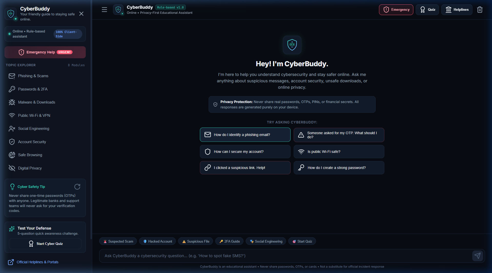
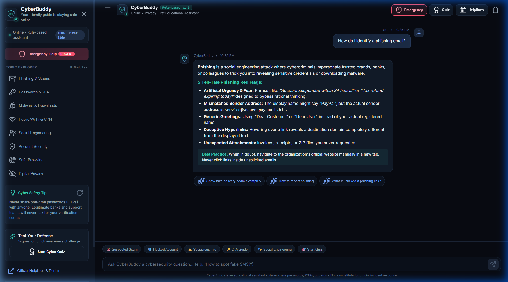
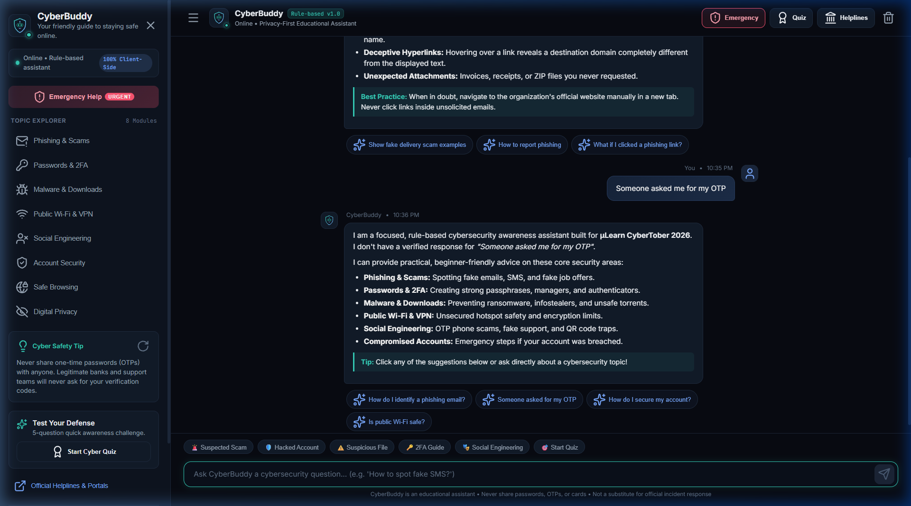
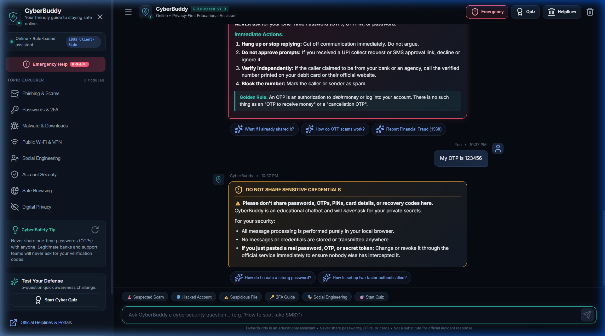
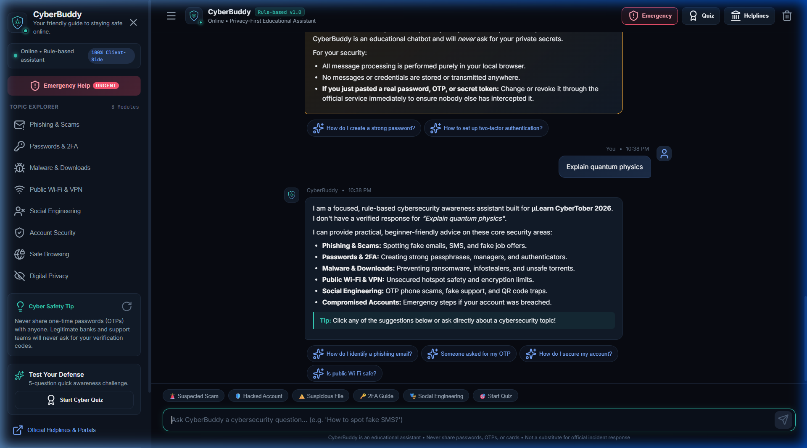
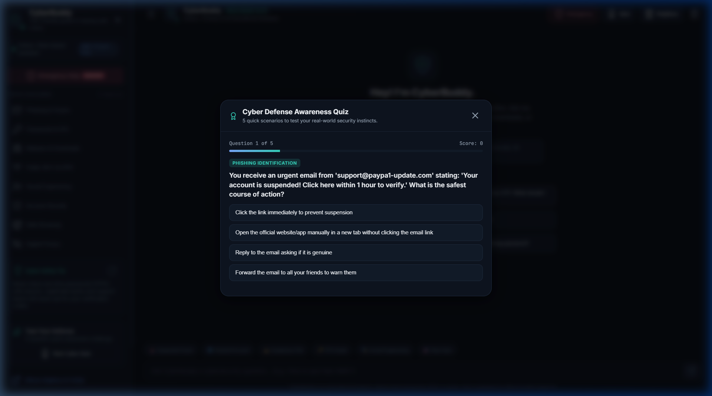
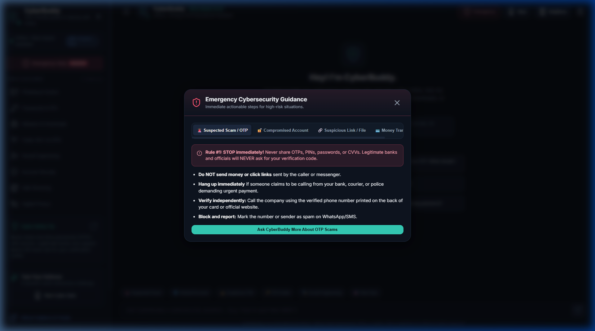
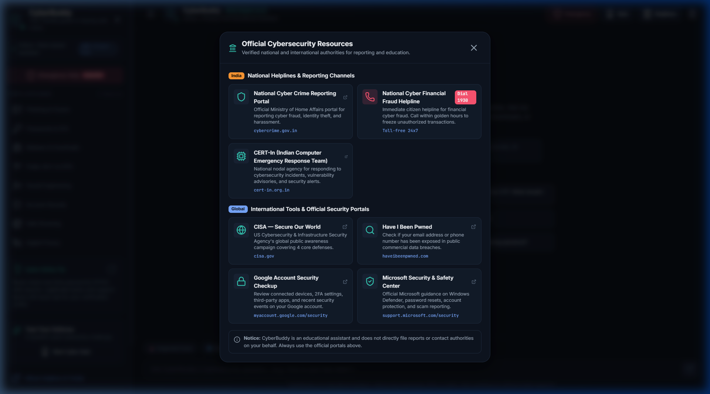
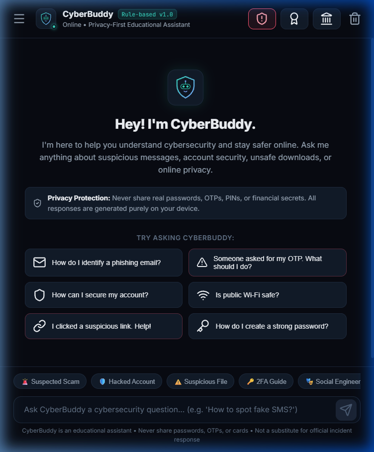

# CyberBuddy 🛡️🤖
> **"Your friendly guide to staying safe online."**  
> An interactive, privacy-first, client-side cybersecurity awareness assistant.

**Repository:** [https://github.com/rafasidhik/cyberbuddy](https://github.com/rafasidhik/cyberbuddy)  
**Live Demo:** [https://rafasidhik.github.io/cyberbuddy/](https://rafasidhik.github.io/cyberbuddy/)

---

## 📌 Project Overview

**CyberBuddy** is a responsive, web-based cybersecurity awareness chatbot designed to help users navigate everyday digital threats. Its purpose is to provide clear, practical, and beginner-friendly guidance on online safety—from spotting phishing scams and securing compromised accounts to understanding malware risks and protecting personal privacy.

Built with a strict privacy-first architecture, CyberBuddy operates entirely in the browser. It delivers instant, actionable advice without requiring user accounts, external AI APIs, backend servers, or data collection.

- **GitHub Repository:** [https://github.com/rafasidhik/cyberbuddy](https://github.com/rafasidhik/cyberbuddy)
- **Live Website:** [https://rafasidhik.github.io/cyberbuddy/](https://rafasidhik.github.io/cyberbuddy/)

---

## ✨ Features

- **Conversational Cybersecurity Guidance:** Provides structured answers and warning signs across 8 core domains:
  - Phishing and email scams (fake banks, fake job offers, parcel SMS scams)
  - Password security, password managers, and two-factor authentication (2FA / Passkeys)
  - Malware defense, safe downloads, and ransomware isolation
  - Public Wi-Fi security and VPN capabilities vs. limitations
  - Social engineering, QR code fraud ("quishing"), and impersonation tactics
  - Account security audits and session management
  - Safe browsing, typosquatting, and malvertising defense
  - Digital privacy, app permissions, and tracking prevention
- **High-Priority Emergency Workflows:** Dedicated response flows for urgent scenarios:
  - Suspected scam calls and OTP requests
  - Compromised or hacked accounts (Instagram, email, Google)
  - Suspicious links clicked or unknown files downloaded
  - Financial cyber fraud protocols and official emergency helplines
- **Sensitive Data Protection Pre-Filter:** Automatically intercepts potential secrets (OTPs, PINs, card numbers, passwords, recovery codes) before processing, warning the user without ever echoing or storing the sensitive value.
- **Interactive Cyber Defense Quiz:** Built-in 5-question challenge covering real-world security scenarios with immediate feedback, explanations, and score tracking.
- **Daily Cyber Safety Tips:** Rotating deck of practical daily security habits.
- **Verified Official Resources Directory:** Instant access to authorized reporting portals and helplines (including India's 1930 helpline and international security centers).
- **Responsive & Accessible Interface:** Clean dark cybersecurity theme with full desktop sidebar navigation, mobile drawer support, keyboard focus states, and zero horizontal overflow.

---

## 📸 Screenshots

| Main Interface | Phishing Advisory |
| :---: | :---: |
|  |  |

| Emergency Scam Protocol | Privacy Safeguard Filter |
| :---: | :---: |
|  |  |

| Out-of-Scope Fallback | Interactive Defense Quiz |
| :---: | :---: |
|  |  |

| Emergency Guidance Desk | Verified Helplines Directory |
| :---: | :---: |
|  |  |

| Mobile Responsive View (360px) |
| :---: |
|  |

---

## 💻 Tech Stack

- **HTML5:** Semantic structure, accessible landmarks, and modal dialogs.
- **CSS3:** Custom responsive layout, CSS custom properties (design tokens), animations, and dark cyber aesthetic.
- **Vanilla JavaScript (ES6+):** Rule-based intent classification, pre-filter regex matching, quiz state machine, and DOM management.
- **Lucide Icons:** Modern iconography via CDN with defensive runtime checks.
- **SVG:** Custom lightweight vector favicon and branding assets.

No build tools, bundlers, frontend frameworks, or backend runtimes are required.

---

## 🚀 Getting Started

### 1. Clone the Repository
```bash
git clone https://github.com/rafasidhik/cyberbuddy.git
cd cyberbuddy
```

### 2. Run Locally

#### Option A: Python HTTP Server (Recommended)
```bash
python -m http.server 8080
```
Open your browser and navigate to: `http://localhost:8080`

#### Option B: Node.js
```bash
npx -y serve .
```

#### Option C: Direct Browser Launch
You can also open `index.html` directly in any modern web browser (Chrome, Edge, Firefox, Safari).

---

## ⚙️ How It Works

### Rule-Based Architecture
CyberBuddy operates using a multi-stage client-side processing pipeline:
1. **Input Normalization:** Trims whitespace, removes extraneous punctuation, and converts input to lowercase tokens.
2. **Sensitive Information Detection (Pre-Filter):** Regular expressions scan for credentials (4–8 digit OTPs, 16-digit card numbers, passwords, CVVs). If detected, a safety warning is triggered immediately, and the secret is never reflected back to the user.
3. **Emergency Intent Matching:** Prioritizes urgent threats (active scams, hacked accounts, malicious downloads, unauthorized payments) using tokenized regex matching to account for natural phrasing and tense variations.
4. **Topic Classification:** Evaluates standard inquiries against 8 modular cybersecurity knowledge bases using weighted keyword bundles.
5. **Interactive Follow-ups:** Attaches relevant action chips to responses so users can explore next steps with a single click.
6. **Graceful Fallback:** If a query falls outside cybersecurity awareness, CyberBuddy explains its scope and offers quick links back to core topics.

### Privacy-First Approach
- **100% Client-Side:** All logic executes entirely inside the user's browser.
- **Zero Data Transmission:** No conversation messages, IP addresses, or analytics are sent to external servers.
- **Zero Local Persistence:** Conversations exist only in active browser memory. Refreshing the page or clicking "Clear Chat" permanently wipes the session.
- **Safe DOM APIs:** User inputs are rendered using `textContent` rather than raw HTML interpolation, preventing cross-site scripting (XSS).

---

## ⚠️ Limitations

- **Rule-Based Specificity:** Because it relies on predefined keyword sets and regex patterns rather than generative large language models, queries with severe typos or obscure phrasing may trigger the general fallback response.
- **Static Knowledge Base:** Does not pull live, real-time threat intelligence feeds or zero-day CVE advisories.
- **Educational Scope:** CyberBuddy is an educational assistant designed to build awareness and share best practices. It cannot file official police reports, directly freeze bank accounts, or replace professional incident response and legal support.
